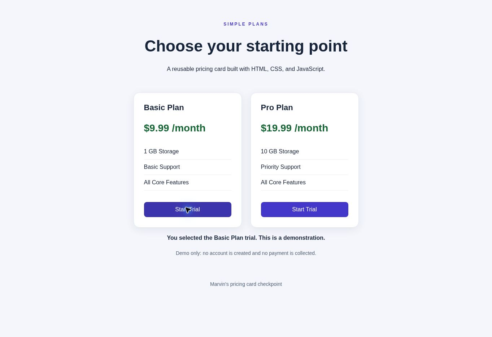

# Pricing Card Refactoring Checkpoint

[Live demo](https://marvericklnk.github.io/pricing-card-checkpoint/)

Before and after implementation using HTML, CSS, and JavaScript, without frameworks.

## Files
- before.html: original broken snippet, preserved for comparison.
- index.html, style.css, script.js: corrected implementation.
- AI-PROMPT.md: AI prompt and tool disclosure.

## Fixes
- Corrected box-shdow to box-shadow.
- Replaced the malformed heading with a properly created h2 element.
- Added viewport, language, encoding, and page title.
- Added semantic header, main, section, article, and footer elements.
- Applied border-box sizing, maximum width, and wrapping for narrow screens.
- Extracted repeated markup into Card(title, price, features).
- Connected each button to a visible, accessible selected-plan message.
- Added keyboard focus styling and descriptive button labels.

## Run and check
Open index.html in a browser or use Live Server. Check both plan buttons, use Tab and Enter to activate them, and resize to 320px wide. Each button must announce its own plan; cards should wrap without horizontal overflow. Open before.html separately to compare the original.

Trial selection is a demo only: it does not start a real trial or create an account.

## AI workflow
Prepared with ChatGPT/Codex. The assignment explicitly asks for Cursor: that step still needs to be performed in Cursor using AI-PROMPT.md and before.html. No Cursor session or Cursor test results are claimed here.
